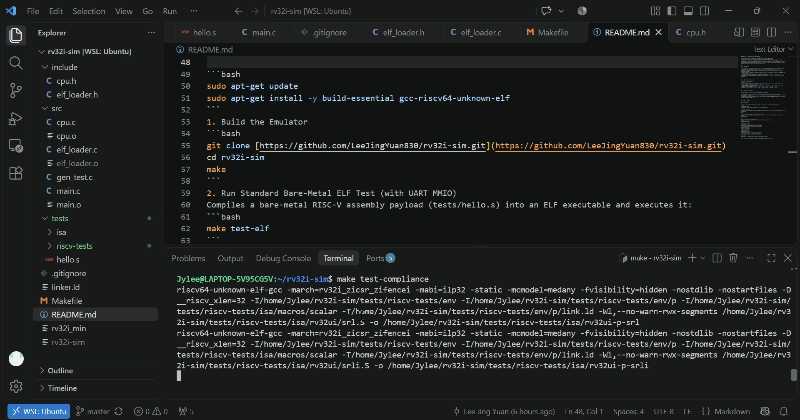

# RV32I-Sim: A Lightweight RISC-V CPU Emulator

[](https://github.com/LeeJingYuan830/rv32i-sim/actions/workflows/ci.yml)
[](LICENSE)
[](#)
[](#)

A from-scratch, modular 32-bit RISC-V (`RV32I`) instruction set emulator written in ANSI C. This project simulates the core Fetch-Decode-Execute pipeline of a modern processor, bridging the gap between digital hardware architecture and low-level systems programming.

---

## 🚀 Key Features

- **Architectural Verification**: 100% compliant with the unprivileged specification, passing all **42 official RV32UI** compliance test cases from `riscv-software-src/riscv-tests`.
- **Custom ELF32 Loader**: Built-in parser (`elf_loader.c`) that directly parses 32-bit RISC-V ELF executables, resolves `PT_LOAD` segments, extracts execution entry points, and monitors the `tohost` communication symbol.
- **Memory-Mapped I/O (MMIO)**: Implements a hardware-accurate serial UART output port at `0x10000000` for console communication.
- **Physical Memory Mapping**: Supports dynamic high-base physical RAM spaces (`0x80000000`) with Little-Endian byte-level manipulation and boundary protection.
- **Lightweight & Dependency-Free**: Built entirely with standard C libraries without external runtime overhead.

---

## 🧠 Implemented Instructions

| Category | Instructions |
| :--- | :--- |
| **ALU (I-Type/R-Type)** | `add`, `addi`, `sub`, `sll`, `slli`, `slt`, `slti`, `sltu`, `sltiu`, `xor`, `xori`, `srl`, `srli`, `sra`, `srai`, `or`, `ori`, `and`, `andi` |
| **Upper Immediate (U-Type)** | `lui`, `auipc` |
| **Control Flow (B-Type/J-Type/I-Type)** | `beq`, `bne`, `blt`, `bge`, `bltu`, `bgeu`, `jal`, `jalr` |
| **Memory Access (Load/Store)** | `lw`, `lh`, `lhu`, `lb`, `lbu`, `sw`, `sh`, `sb` |
| **System & Memory Sync** | `ecall`, `ebreak`, `fence`, `fence.i`, CSR stubs (`zicsr`) |

---

## 🔍 Internal Architecture

The core pipeline strictly follows the Von Neumann architecture:

1. **Fetch**: Reads 32-bit instructions from simulated Little-Endian memory with PC alignment.
2. **Decode**: Extracts opcode, funct3, funct7, and performs sign-extended immediate reconstruction across all formats (I, S, B, U, J).
3. **Execute**: Evaluates arithmetic/branch logic, interfaces with memory/MMIO, and updates architectural registers ($x_0$ hardwired to 0).

---

## 🛠️ Build and Run

### Prerequisites

Ensure GCC and the RISC-V bare-metal toolchain are installed on your Linux/WSL environment:

```bash
sudo apt-get update
sudo apt-get install -y build-essential gcc-riscv64-unknown-elf
```
1. Build the Emulator
```bash
git clone [https://github.com/LeeJingYuan830/rv32i-sim.git](https://github.com/LeeJingYuan830/rv32i-sim.git)
cd rv32i-sim
make
```
2. Run Standard Bare-Metal ELF Test (with UART MMIO)
Compiles a bare-metal RISC-V assembly payload (tests/hello.s) into an ELF executable and executes it:
```bash
make test-elf
```

3. Run Official RISC-V Compliance Suite
Batch-compiles and executes the official riscv-tests (RV32UI test suite):
```bash
make test-compliance
```
Verification Output:
```Plaintext
==================================================
Running Official RISC-V Compliance Tests (RV32UI)...
==================================================
[PASS] rv32ui-p-add
[PASS] rv32ui-p-addi
[PASS] rv32ui-p-and
...
[PASS] rv32ui-p-xor
[PASS] rv32ui-p-xori
==================================================
Test Summary: Total 42 | Passed: 42 | Failed: 0
==================================================
```
📜 License
This project is open-source and available under the MIT License.

Built for architectural exploration and systems engineering by Jing Yuan Lee.

Markdown
<p align="center">
  
</p>
